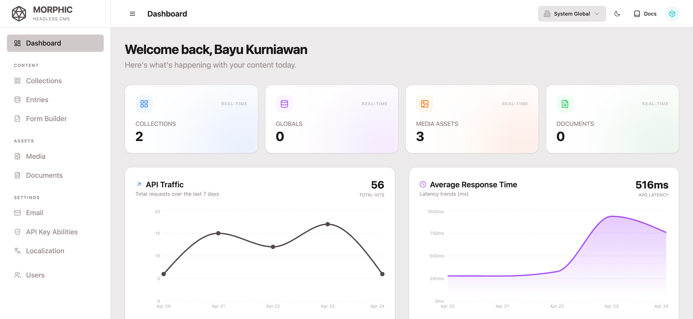

<div align="center">
  

# MORPHIC CMS

**The Edge-Ready, High-Performance Headless CMS for Modern Developers.**

🌐 [Official Website](https://morphic-cms.com) | 📖 [Documentation](https://morphic-cms.com/docs)

[](https://vercel.com/new/clone?repository-url=https%3A%2F%2Fgithub.com%2Fbayukurniawan30%2Fmorphic-cms&env=DATABASE_URL,JWT_SECRET,JWT_EXPIRES_IN_DAYS,STORAGE_SERVICE,CLOUDINARY_API_KEY,CLOUDINARY_API_SECRET,CLOUDINARY_CLOUD_NAME,CLOUDINARY_UPLOAD_PRESET,EMAIL_SERVICE,RESEND_API_KEY,EMAIL_FROM,SIMPLE_HOMEPAGE,CLOUDFLARE_TURNSTILE_SITE_KEY,CLOUDFLARE_TURNSTILE_SECRET_KEY,APP_DOMAIN,IS_SELF_HOSTED)

_Built with Hono and Postgres JSONB to eliminate database schema friction entirely._

</div>

---

### 🚀 Why Morphic?

Morphic CMS isn't just another content manager. It's a lightweight, developer-first platform designed to run at the **Edge**. While other CMSs feel heavy and bloated, Morphic stays agile—leveraging a serverless-first stack that ensures your API is as fast as your content delivery network.

- **⚡ Blazing Fast**: Built on Hono, the ultra-lightweight web framework.
- **🧬 Zero-Migration Architecture**: Define fields dynamically in the UI. Morphic handles storage inside a single PostgreSQL JSONB column—no rigid table schemas or risky database migrations.
- **☁️ Serverless & Edge-Ready**: Perfect for Vercel, Cloudflare Workers, and Neon DB.
- **🎨 Premium UI**: A sleek, dark-themed dashboard that doesn't just work—it looks incredible.
- **🏗️ Developer Experience**: Type-safe with Drizzle ORM and built with the power of React + Inertia.js.

---

### ✨ Key Features

- **🌐 Multi-tenant Architecture**: Scale your SaaS easily. Manage isolated organizations and workspaces from a single instance.
- **🛠️ Dynamic Schema Builder**: Define custom collections and global settings with a powerful, intuitive field system.
- **📁 Smart Media Management**: Seamlessly integrated Cloudinary support with automatic, tenant-based organization.
- **📋 Public Forms & Custom Branding**: Publish beautiful public questionnaires/forms directly from internal collections with custom header images, footer texts, and 8 theme color presets.
- **🛡️ Bot Mitigation & Rate Limiting**: Out-of-the-box integration with Cloudflare Turnstile and IP-based rate limiting to prevent spam submissions.
- **🔒 Secure by Design**: Tenant-scoped REST API with JWT authentication and granular API Key permissions.
- **🌍 Built-in i18n**: Native multi-language support for global content strategies.
- **📊 Real-time Analytics**: Built-in API usage tracking and performance monitoring out of the box.

---

### 📋 Public Forms & Security (Cloudflare Turnstile)

Morphic CMS lets you publish collection schemas as public forms. You can brand them with customized header images (integrated with media manager), custom titles/footers, and 8 curated HSL color themes (`slate`, `emerald`, `blue`, `indigo`, `violet`, `rose`, `orange`, `yellow`).

#### Form Status Control

Each public form can be turned online or offline instantly:

- **Active Toggle**: Control form availability via the **"Status: Open for submissions"** switch in the dashboard.
- **Closed Screen**: When toggled off, visitors are greeted with a premium restricted/closed screen, and the API rejects any programmatic submits.

#### Bot Mitigation Setup

To protect your public forms from spam, Morphic integrates Cloudflare Turnstile:

1. Register your site on [Cloudflare Turnstile](https://www.cloudflare.com/products/turnstile/).
2. Add the site key and secret key to your `.env` file:
   ```env
   CLOUDFLARE_TURNSTILE_SITE_KEY=your_turnstile_site_key
   CLOUDFLARE_TURNSTILE_SECRET_KEY=your_turnstile_secret_key
   ```
3. **Local Dev Bypass**: Turnstile challenges and origin validation are automatically bypassed when testing on `localhost` or `127.0.0.1` for local developer convenience.
4. **IP Rate Limiting**: Form submissions are protected by a built-in rate limiter (max 5 submissions per 15 minutes per IP per form).

---

### 🌐 Multi-Tenant Subdomain Routing

Morphic CMS supports isolated multi-tenant routing using subdomains (e.g. `tenant-slug.yourdomain.com`).

To configure subdomains for your custom domain:

1. In Vercel or your hosting provider, add a wildcard domain mapping (e.g., `*.yourdomain.com`).
2. Add the `APP_DOMAIN` environment variable in your `.env` file:
   ```env
   APP_DOMAIN=yourdomain.com
   ```
   If `APP_DOMAIN` is not set, it defaults to `morphic-cms.com`.

_Note: For local development, subdomain redirects are automatically bypassed when accessing raw `localhost` to avoid browser cookie domain restrictions._

---

### 🖥️ SaaS vs Self-Hosted Mode

Morphic CMS can operate as a multi-tenant Cloud SaaS or as a standalone Self-Hosted instance. This behavior is controlled by the `IS_SELF_HOSTED` environment variable:

```env
IS_SELF_HOSTED=true
```

- **`true` (Default)**: Standalone self-hosted mode. Disables all tier-based limits (unlimited workspaces, user seats, collections, webhooks, and localizations).
- **`false`**: Cloud SaaS mode. Enforces workspace limits, storage ceilings, user seats, and localized collections restrictions based on the owner's billing tier (FREE vs PRO).

---

### 🛠️ The "Edge-First" Tech Stack

Morphic leverages the most cutting-edge tools in the ecosystem:

| Layer        | Technology                               | Why?                                                                        |
| ------------ | ---------------------------------------- | --------------------------------------------------------------------------- |
| **Core**     | [Hono](https://hono.dev/)                | Sub-millisecond overhead, runs on any runtime.                              |
| **Database** | [Neon PostgreSQL](https://neon.tech/)    | Serverless, autoscaling, and perfect for ultra-fast JSONB document queries. |
| **ORM**      | [Drizzle ORM](https://orm.drizzle.team/) | TypeScript-first, zero-runtime overhead.                                    |
| **Bridge**   | [Inertia.js](https://inertiajs.com/)     | The feel of an SPA with the simplicity of server-side routing.              |
| **Styling**  | [Tailwind CSS](https://tailwindcss.com/) | Rapid, beautiful, utility-first design.                                     |

---

### 📦 Quick Start

#### Create a New Self-Hosted Instance

The guided installer creates a new Morphic CMS project, writes its initial environment file, and can apply database migrations and seed the first administrator:

```bash
npx create-morphic-cms@latest my-cms
cd my-cms
pnpm dev
```

To pin the CMS starter to a release, use `--ref v1.4.1`. Run `npx create-morphic-cms@latest --help` for database, administrator, and deployment options.

#### JavaScript / TypeScript SDK

Use the framework-neutral [`@morphic-cms/sdk`](https://www.npmjs.com/package/@morphic-cms/sdk) to consume the REST API with typed entries, pagination, and exact field filters:

```bash
pnpm add @morphic-cms/sdk
```

```ts
import { createMorphicClient } from '@morphic-cms/sdk'

const cms = createMorphicClient({
  baseUrl: 'https://your-cms-domain.com',
  apiKey: process.env.MORPHIC_API_KEY,
  tenantId: process.env.MORPHIC_TENANT_ID,
})

const posts = await cms.entries.list('posts', { page: 1, limit: 10 })
```

Keep API keys in server-side environment variables; do not expose a write-capable key in browser code.

#### Entry Filters (REST)

Filter top-level schema fields on `GET /api/collections/:idOrSlug/entries`:

| Field type | Example | Matching behavior |
| --- | --- | --- |
| Text / Textarea | `filter[title]=Hello` or `filter[title][eq]=Hello` | Case-sensitive equality |
| Text / Textarea | `filter[title][icontains]=hello` | Case-insensitive contains; `%`, `_`, and backslashes are literal |
| Date | `filter[publish_date]=2026-10-25` or `filter[publish_date][eq]=2026-10-25` | Single date |
| Date | `filter[publish_date][gte]=2026-10-01&filter[publish_date][lte]=2026-10-31` | Inclusive range; either boundary can be omitted |
| Relation | `filter[category]=42` or `filter[category][eq]=42` | Connected entry ID |
| Select / Radio | `filter[priority]=high` | Exact configured option value; multi-value Select fields are unsupported |
| Boolean | `filter[featured]=true` | `true` or `false` |

Filters combine with AND before pagination, so totals count only matching entries. Dates must be valid `YYYY-MM-DD` values; reversed ranges are rejected, and missing or empty dates do not match. Date filtering does not include Time/Datetime fields or timezone conversion.

For relations, use the **field name inside the source collection**. If Posts has a relation field named `category` connected to Categories, `filter[category]=42` returns Posts referencing Categories entry 42. If that field is named `post_category`, use `filter[post_category]=42`. IDs must be positive integers. Matching uses the stored reference even when the target is unpublished or deleted; relation population remains unchanged. Filtering by a connected entry's title/slug or multiple IDs is unsupported.

For example, run this from server-side code or your terminal:

```bash
curl -G 'https://your-cms-domain.com/api/collections/posts/entries' \
  -H "Authorization: Bearer $MORPHIC_API_KEY" \
  -H "X-Tenant-ID: $MORPHIC_TENANT_ID" \
  --data-urlencode 'filter[title][icontains]=hello' \
  --data-urlencode 'filter[publish_date][gte]=2026-10-01' \
  --data-urlencode 'filter[publish_date][lte]=2026-10-31' \
  --data-urlencode 'filter[category]=42'
```

#### Filter Controls in API Preview

Open a collection's **Entries → API Preview**, then select **REST Preview** or **GraphQL Preview**. Choose **Add filter**, select a field and match type, enter a value, and choose **Apply filters**. Applying filters resets pagination to page 1; all selected filters must match.

Text/Textarea fields offer equality and case-insensitive contains. Date fields offer a single date or inclusive range with either boundary optional. Boolean and Select/Radio fields use value pickers; Relation fields accept a connected entry ID. Only supported top-level fields appear. Invalid values and reversed ranges show a validation message before applying.

Filters are shared between preview tabs. The REST URL, copied URL/cURL, GraphQL query, and live responses use the applied filters. Editing controls does not change the request until you apply them. Remove a row and apply again, or choose **Clear filters** to remove all filters immediately.

#### Entry Sorting

REST uses `sortBy` and `sortDir` (`asc` or `desc`):

```http
GET /api/collections/posts/entries?sortBy=publish_date&sortDir=desc
GET /api/collections/products/entries?sortBy=price&sortDir=asc
```

Supported **top-level, single-value schema fields**:

| Type | Ascending order |
| --- | --- |
| Number | Numeric, e.g. 2 before 10 |
| Text | Alphabetical, case-insensitive |
| Email | Alphabetical, case-insensitive |
| Date | Oldest date first, using valid YYYY-MM-DD values |
| Boolean | false before true |

Other schema types—including Textarea, Slug, Select/Radio, Relation, Time/Datetime, arrays and groups—are not sortable. Use schema field names such as `price`, not labels or nested paths.

System fields `id` and `createdAt` remain supported and take precedence over schema fields with those names. The default is `createdAt` descending. If `sortDir` is omitted, it defaults to `desc`. Missing, null, empty-string, or invalidly typed schema values sort last in both directions; invalid dates also sort last. Equal values use ID ascending as a tie-breaker. Filtering and sorting happen before pagination. Unknown/unsupported fields and invalid directions return HTTP 400 in REST or GraphQL `BAD_USER_INPUT`. No database migration is needed; large collections may benefit from indexes for frequently sorted fields.

GraphQL uses the same arguments on `entriesPage` (and the legacy `entries` query):

```graphql
query SortedProducts {
  entriesPage(collectionSlug: "products", sortBy: "price", sortDir: "asc") {
    entries { id content }
    pagination { currentPage totalPages totalCount limit }
  }
}
```

#### GraphQL Entry Filters

Send a `POST` to `/api/graphql` with `Authorization: Bearer YOUR_API_KEY`, `X-Tenant-ID: YOUR_TENANT_ID`, and `Content-Type: application/json`. Put the query below in the JSON body's `query` property (and supply the optional `variables` property for queries using variables).

```graphql
query FilteredPosts {
  entriesPage(
    collectionSlug: "posts"
    page: 1
    limit: 10
    sortBy: "publish_date"
    sortDir: "desc"
    filters: {
      title: { icontains: "hello" }
      publish_date: { gte: "2026-10-01", lte: "2026-10-31" }
      category: { eq: 42 }
    }
  ) {
    entries { id content }
    pagination { currentPage totalPages totalCount limit }
  }
}
```

`filters` is a JSON scalar using schema field names. Replace `title`, `publish_date`, and `category` with fields defined in your Posts collection. All matching and validation rules from REST apply, including AND logic before pagination.

- Text equality: `filters: { title: "Hello" }` or `{ title: { eq: "Hello" } }`.
- Text contains: `filters: { title: { icontains: "hello" } }`.
- Single date: `filters: { publish_date: "2026-10-25" }` or `{ publish_date: { eq: "2026-10-25" } }`.
- Date range: `filters: { publish_date: { gte: "2026-10-01", lte: "2026-10-31" } }`. Either boundary can be omitted.
- Relation ID: `filters: { category: 42 }` or `{ category: { eq: 42 } }`.
- Select/Radio/Boolean: `filters: { priority: "high", featured: true }`.

Invalid filters return HTTP 400 in REST or a GraphQL error with code `BAD_USER_INPUT`. The legacy GraphQL `entries` query also accepts filters, but use `entriesPage` for pagination metadata.

#### One-Click Deploy

The fastest way to get Morphic running is to click the **Deploy with Vercel** button above. It will set up your repository, environment variables, and initial deployment in seconds.

#### Local Development

1. **Clone & Install**:

   ```bash
   git clone https://github.com/bayukurniawan30/morphic-cms.git
   cd morphic-cms
   pnpm install
   ```

2. **Configure Environment**:
   Copy `.env.example` to `.env` and fill in your database, Cloudinary, and optional `SIMPLE_HOMEPAGE` and `APP_DOMAIN` settings.

3. **Database Setup**:

   ```bash
   pnpm run db:push    # Push schema to Neon
   pnpm run db:seed    # Seed initial admin user
   ```

4. **Run**:
   ```bash
   pnpm run dev
   ```

---

### 🚀 Deployment

#### 🐳 Deploying with Docker (VPS Setup)

Morphic CMS includes a fully configured `Dockerfile` and `docker-compose.yml` for easy deployment to any VPS (DigitalOcean, Hetzner, AWS EC2, etc.).

1. **Clone the repository on your server**:

   ```bash
   git clone https://github.com/bayukurniawan30/morphic-cms.git
   cd morphic-cms
   ```

2. **Configure Environment**:
   Open `docker-compose.yml` and set up your Cloudinary credentials under the `environment` section.

3. **Start the containers**:

   ```bash
   docker compose up -d
   ```

4. **Initialize the Database**:
   You need to push the schema to your new local PostgreSQL container:
   ```bash
   docker compose exec morphic pnpm run db:push
   docker compose exec morphic pnpm run db:seed
   ```

Your CMS is now running on `http://your-server-ip:3000`. We recommend putting it behind an Nginx reverse proxy with SSL (e.g., using Certbot).

#### ☁️ Deploying to AWS (Serverless)

For an enterprise-grade setup entirely on AWS, you can utilize a true Serverless architecture using AWS Lambda, S3, CloudFront, and Amazon RDS.

1. **Database (Amazon Aurora)**:
   Provision an **Amazon Aurora Serverless v2 (PostgreSQL)** database. Copy the connection string and set it as your `DATABASE_URL`.
2. **API (AWS Lambda)**:
   Morphic is built on Hono, which has first-class AWS Lambda support.
   - Install the adapter: `pnpm add hono/aws-lambda`
   - Create a Lambda entry point (`lambda.ts`) using the `handle` function from `hono/aws-lambda` wrapping the app from `src/api/index.ts`.
   - Deploy this function using AWS SAM, CDK, or Serverless Framework.
3. **Static Assets (Amazon S3 + CloudFront)**:
   - Build the frontend: `pnpm run build`
   - Upload the contents of the `./dist` folder to an Amazon S3 bucket.
   - Put an Amazon CloudFront distribution in front of your S3 bucket to serve static assets globally. Ensure CloudFront is configured to route `/api/*` and non-asset requests back to your Lambda function URL or API Gateway.
4. **Email (Amazon SES vs Resend)**:
   Morphic supports both Resend (default) and Amazon SES out-of-the-box. To use SES for a 100% AWS-native stack, simply set `EMAIL_SERVICE=SES` in your environment variables and provide your AWS credentials (`AWS_REGION`, `AWS_ACCESS_KEY_ID`, `AWS_SECRET_ACCESS_KEY`).
5. **Storage (Amazon S3 vs Cloudinary)**:
   Morphic supports both Cloudinary (default) and Amazon S3. To use S3 for a 100% AWS-native stack, set `STORAGE_SERVICE=S3` and provide your AWS credentials as well as `AWS_S3_BUCKET`. Make sure your bucket allows public read access.

---

### 🤝 Contributing

We love stars! ⭐ If you find Morphic useful, please give it a star on GitHub to help others find it.

Morphic is an open-source project. Feel free to open issues or submit PRs to help us build the fastest CMS on the web.

---

<div align="center">
  <p>Made with ❤️ by <b>Bayu Kurniawan</b></p>
</div>
